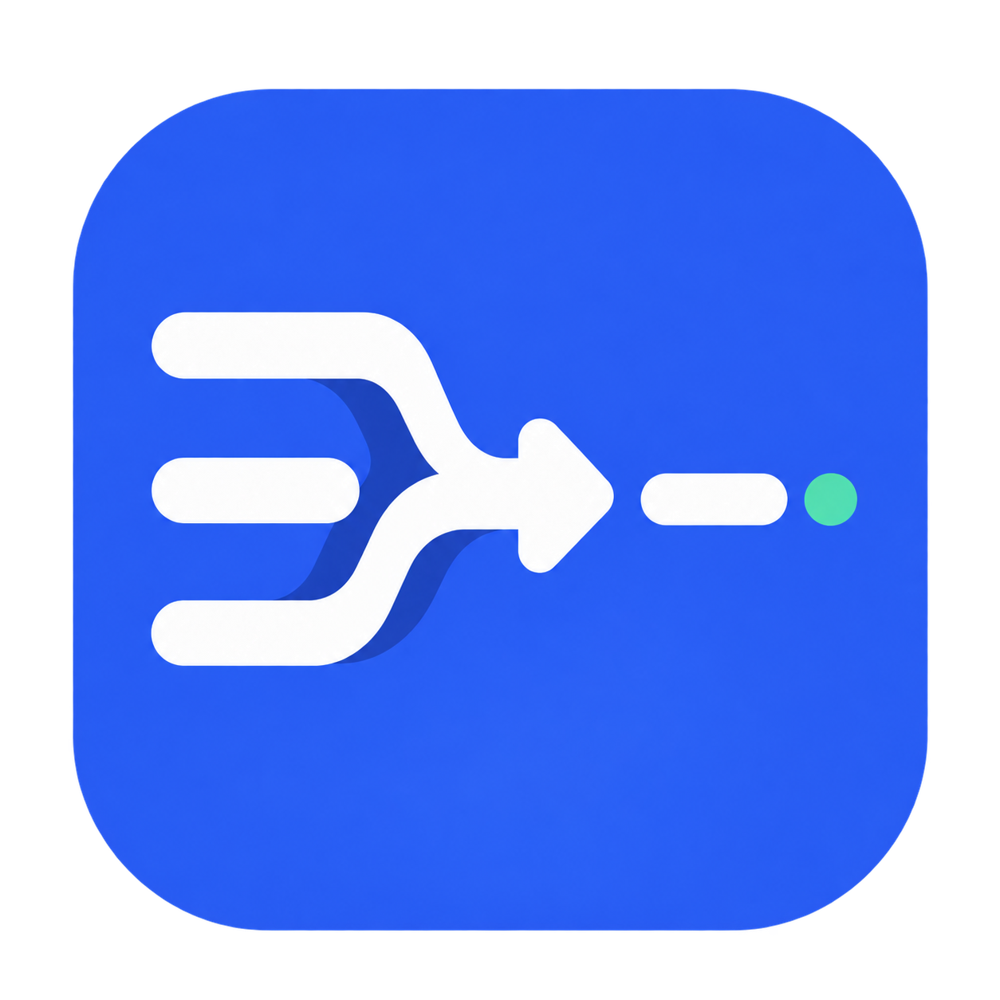

<div align="center">
  
  <h1>Input to English</h1>
  <p><strong>Write naturally. Translate in place. Send when you're ready.</strong></p>
  <p>在熟悉的输入框里写作，一键翻译成英文，由你确认后再发送。</p>
  <p>
    
    
    
  </p>
  <p>
    <a href="#quick-start">Quick start</a> ·
    <a href="#supported-sites">Supported sites</a> ·
    <a href="#configure-providers">Providers</a> ·
    <a href="#privacy-and-security">Privacy</a> ·
    <a href="#troubleshooting">Troubleshooting</a>
  </p>
</div>

---

Input to English adds a small **→ EN** control beside your active editor on ChatGPT, Claude, Gemini and X. It replaces only the text you wrote. It does not submit a prompt or publish a post.

> **You stay in control:** write → translate → review → submit yourself. Use **Undo** to restore your original text while the Undo window is available.

## Supported sites

| Site | Where the control appears |
| --- | --- |
| [ChatGPT](https://chatgpt.com) | Active prompt editor |
| [Claude](https://claude.ai) | Active prompt editor |
| [Gemini](https://gemini.google.com) | Focused web chat editor; this is a supported site, not a translation provider |
| [X](https://x.com) | Focused post, reply, quote commentary or thread entry; excludes DMs and Grok |

Gemini and X target Edge for initial verification; their adapters are shared with Chrome.

| Translation provider | What you need | Where prompt text goes |
| --- | --- | --- |
| **Browser Local** | A supported browser and available language pack | Stays on your device |
| **DeepSeek** | Your own API key | Official DeepSeek API |
| **Kimi** | Your own API key | Official Kimi API |

Only the provider you select is used. There is no automatic fallback.

## Prerequisites

- A current Node.js LTS release with npm
- Chrome 138 or later for Browser Local Translation
- Edge 148 or later for Browser Local Translation
- An authenticated session for the site you want to use
- Optional: a DeepSeek or Kimi API key for the matching cloud provider

Browser Local support is determined by the browser at runtime. Browser version alone does not guarantee that every source-language pack is available.

## Quick start

### 1. Install dependencies and verify

```console
npm install
npm test
npm run typecheck
```

### 2. Build the extension

```console
npm run build:chrome
npm run build:edge
```

The unpacked extensions are written to:

- `.output/chrome-mv3`
- `.output/edge-mv3`

Optional zip archives can be created with:

```console
npm run zip:chrome
npm run zip:edge
```

### 3. Load the unpacked extension

#### Chrome

1. Open `chrome://extensions`.
2. Enable **Developer mode**.
3. Select **Load unpacked**.
4. Choose `.output/chrome-mv3`.

#### Edge

1. Open `edge://extensions`.
2. Enable **Developer mode**.
3. Select **Load unpacked**.
4. Choose `.output/edge-mv3`.

After loading the extension, open its **Options** page to select and configure one provider. Reload an already-open supported-site tab after installing or rebuilding the extension. After updating, confirm the browser has granted access to Gemini and X as well.

## Use it

1. Open a supported site and focus the input editor. On Gemini and X, the control appears only after you focus a supported editor.
2. Enter a prompt in Chinese, Japanese, French, or another supported source language.
3. Press `-> EN`.
4. Review the English replacement, then submit it yourself if it is correct.
5. Press **Undo** to restore the original prompt while Undo is still available.

Undo is deliberately invalidated after you edit or submit the translated prompt, start another translation, navigate, or allow the Undo window to expire. If the prompt changes while a translation request is running, the extension keeps the newer prompt instead of overwriting it.

On Gemini and X, only one control follows the focused editor. Switching to another editor cancels the previous translation and invalidates its Undo. Clicking the extension's own buttons retains the current target. Quoted posts, received replies and page content are never translated.

Links, `@usernames`, `#hashtags`, emoji and line breaks are protected on the new sites. If a provider changes or loses the protected markers, no replacement occurs. Unsupported embedded rich content is also left untouched. Only editor text is replaced; attachments and quote/reply context are not modified. English that exceeds X's limit is written in full; review X's native counter and shorten it yourself before posting.

## Configure providers

Only the selected provider is used. The extension does not silently fall back to another provider.

### Browser Local

Browser Local keeps prompt text on the device and uses the browser's Language Detector and Translator APIs. In Options, select **Browser Local** and press **Check availability**.

The browser may download a language model the first time a particular language pair is used. Keep the browser open and retry after the download finishes. If Browser Local remains unavailable, update the browser and confirm that its built-in AI language features are enabled and supported on the device.

### DeepSeek

1. Select **DeepSeek** in Options.
2. Enter your DeepSeek API key and model ID.
3. Press **Save credentials** and then **Test connection**.

The default model ID is `deepseek-flash`, and it can be edited. Translated prompt text is sent to the official DeepSeek API only when DeepSeek is selected and you press `-> EN`.

### Kimi

1. Select **Kimi** in Options.
2. Enter your Kimi API key and model ID.
3. Press **Save credentials** and then **Test connection**.

The default model ID is `kimi-k2.6`, and it can be edited. Translated prompt text is sent to the official Kimi API only when Kimi is selected and you press `-> EN`.

## Privacy and security

- Settings and API keys are stored only in extension-local storage; sync storage is not used.
- API keys stay in the background extension context and are not placed in supported-site page content.
- Browser Local keeps prompt text on this device.
- DeepSeek and Kimi send only the prompt being translated to the selected provider's official API.
- There is no translation history, telemetry, account system, or automatic provider fallback.
- The extension requests access only to ChatGPT, Claude, Gemini, X and the two official cloud API origins.

Never commit real API keys to this repository or paste them into issue reports.

## Troubleshooting

### The `-> EN` control is missing

- Confirm the page is `chatgpt.com`, `claude.ai`, `gemini.google.com` or `x.com`.
- Focus the site's active prompt editor.
- Reload the tab after installing, updating, or rebuilding the extension.
- Confirm the matching unpacked build is enabled on the browser's extensions page.
- On Gemini/X, click inside your own supported composer first. Search, DMs and Grok are excluded. Moving between thread entries switches the translation target.

### The rich editor or protected content cannot be updated

X uses the host's plain-text paste handler to update Draft state; Gemini uses native insertion and waits for Quill to normalize it. No direct DOM rewrite fallback is used. Unsupported embedded content, unavailable editing or invalid protected markers stop the action. If a host fails after partially changing its draft, the error control offers the exact original in a read-only recovery field. Subsequent user edits are never rolled back automatically.

### Browser Local is unavailable or downloading

- Use Chrome 138+ or Edge 148+.
- Open Options and press **Check availability**.
- Keep the browser open while the required language pack downloads.
- Retry on a supported device and source language if the browser reports the pair unavailable.

### DeepSeek or Kimi reports an invalid key

- Re-enter the key in Options and press **Save credentials**.
- Confirm the selected model ID exists for that account.
- Press **Test connection** before returning to ChatGPT or Claude.
- If you no longer want a stored key, press **Delete API key**.

### DeepSeek or Kimi reports a rate limit or service error

Check the provider account quota and service status, then retry later. The extension will not switch providers automatically; choose another provider explicitly if desired.

### Translation failed but my prompt is still present

This is the expected safety behavior. On provider errors, timeouts, malformed responses, or edits during a request, the extension preserves the current prompt and shows a user-safe error.

## Manual verification

The repeatable browser checklist and execution record are in [docs/manual-test-checklist.md](docs/manual-test-checklist.md).
